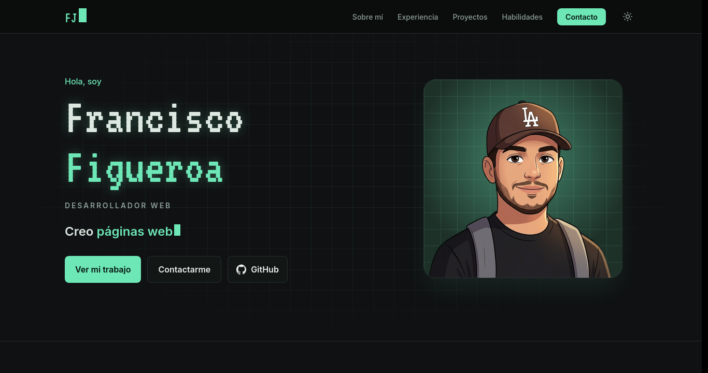

# Portafolio · Francisco Figueroa

Mi portafolio personal como **Desarrollador Web**. Aquí muestro quién soy, mi experiencia, mis proyectos y las tecnologías con las que trabajo.

🔗 **Ver en línea:** https://javierfig0.github.io



## Secciones

- **Inicio:** presentación con una frase animada y mi avatar.
- **Sobre mí:** resumen breve con mis años de experiencia, que se calculan solos.
- **Experiencia:** línea de tiempo con mi trabajo, residencia, cursos y estudios.
- **Proyectos:** proyectos destacados y mis repositorios públicos, que se cargan automáticamente desde la API de GitHub.
- **Habilidades:** tecnologías agrupadas por área, con sus logos.
- **Contacto:** formulario que abre el correo con el mensaje ya escrito, y enlaces directos.

## Características

- Diseño responsive para computadora, tablet y celular.
- Modo claro y oscuro: sigue la configuración del sistema y se puede cambiar a mano. La elección se guarda.
- Menú que marca la sección en la que está el visitante.
- Animaciones al hacer scroll, que se desactivan si el sistema tiene activado "reducir movimiento".
- Sin dependencias que instalar: es HTML, CSS y JavaScript puro.

## Tecnologías

- **HTML5**
- **CSS3** con variables para los temas de color
- **JavaScript** puro, sin frameworks
- **[Tailwind CSS](https://tailwindcss.com)** por CDN
- **[Devicon](https://devicon.dev)** para los logos de tecnologías
- **API de GitHub** para listar mis repositorios
- **Google Fonts:** VT323 e Inter

## Estructura

```
├── index.html          # Estructura y contenido de la página
├── css/
│   └── styles.css      # Colores de cada tema, animaciones y estilos propios
├── js/
│   ├── theme.js        # Aplica el modo claro/oscuro antes de mostrar la página
│   ├── tailwind.config.js  # Colores y tipografías de Tailwind
│   └── main.js         # Frase animada, proyectos de GitHub, menú, tema y formulario
└── img/
    ├── foto-avatar.png # Avatar
    └── preview.png     # Captura para este README
```

## Verlo en tu computadora

No necesita instalación. Clona el repositorio y abre `index.html` en el navegador:

```bash
git clone https://github.com/JavierFig0/JavierFig0.github.io.git
cd JavierFig0.github.io
xdg-open index.html   # en Linux; en Windows o macOS, ábrelo con doble clic
```

## Desarrollo con IA

Este portafolio lo desarrollé con ayuda de **[Claude](https://claude.ai)**, el asistente de IA de Anthropic, usando Claude Code.

Yo definí el estilo, el contenido y la estructura, y revisé cada cambio. La IA me ayudó a escribir el código y a iterar más rápido en el diseño. Usar estas herramientas es parte de mi forma de trabajar.

## Contacto

- **Correo:** franciscofigff12@gmail.com
- **GitHub:** [@JavierFig0](https://github.com/JavierFig0)
